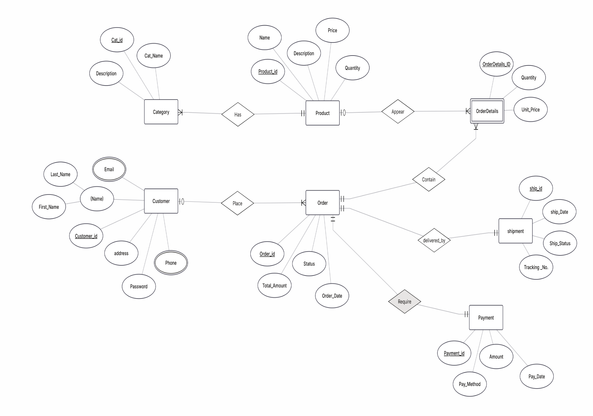
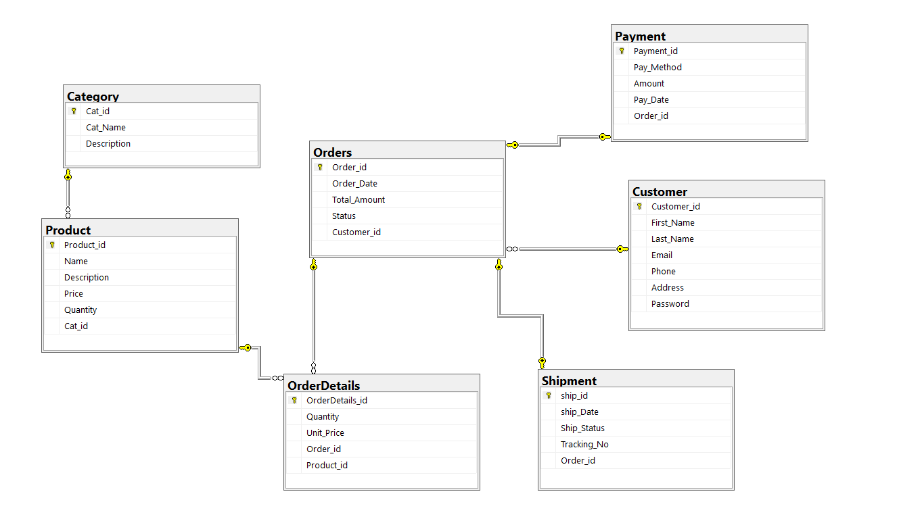
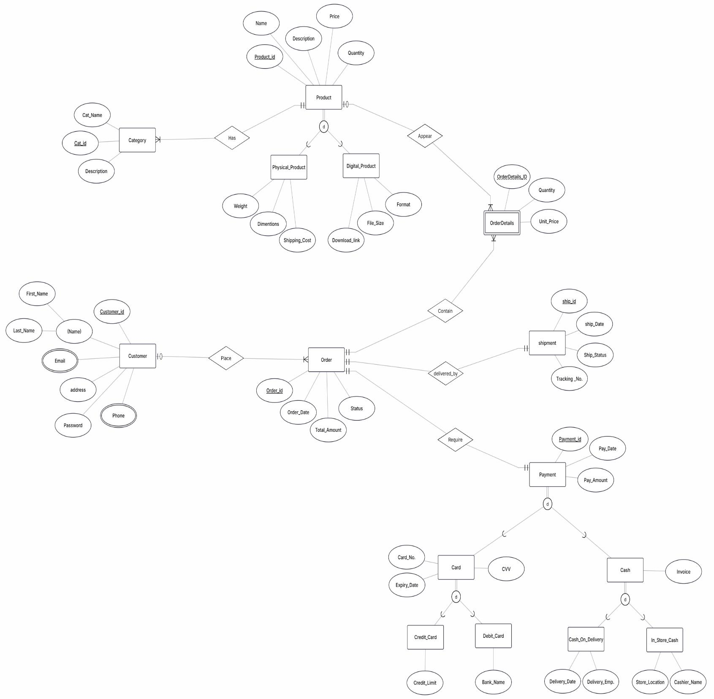
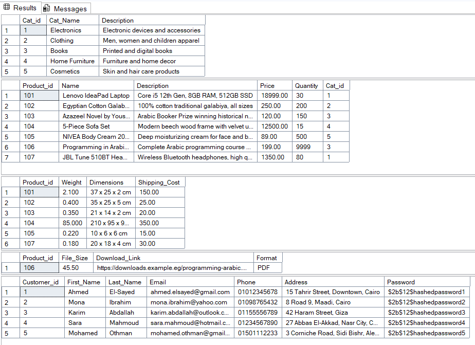
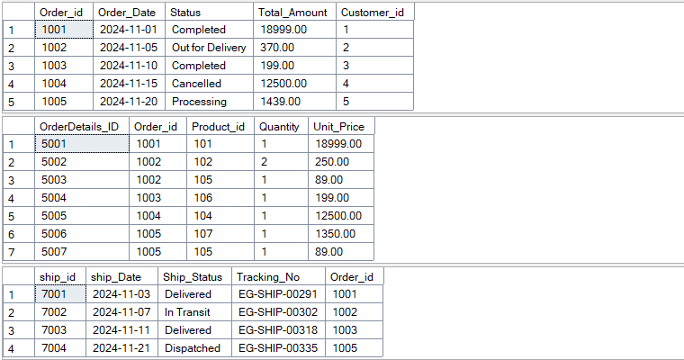
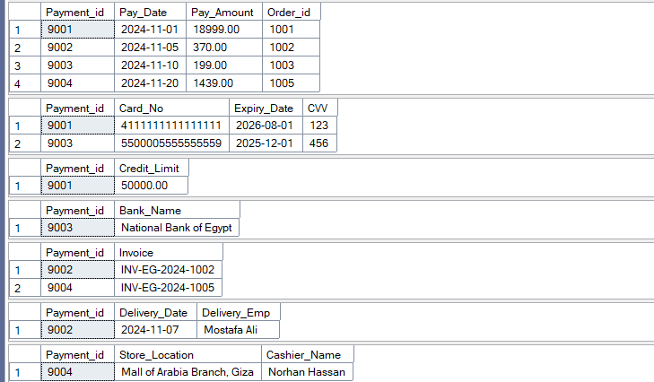
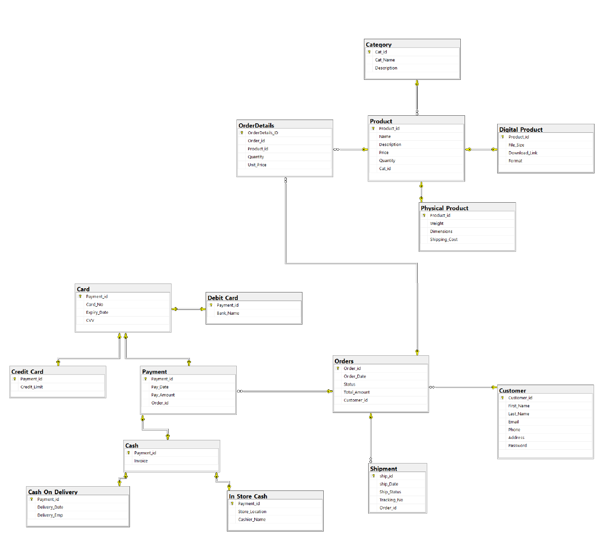

<h1 align="center">Online Store System</h1>
<h3 align="center">Advanced Database – Project</h3>

<p align="center">Supervised by <b>Dr. Ahmed El-Sidawy</b></p>

A relational database design for an online store: customers place orders for physical and digital products, pay by card or cash, and receive shipments. The project goes from a conceptual ERD to an enhanced ERD (with specialization), then to a full SQL Server implementation with sample data.

---

## Table of Contents

1. [ERD](#erd)
2. [Relational Mapping](#relational-mapping)
3. [SQL Diagram](#sql-diagram)
4. [EERD](#eerd)
5. [SQL Implementation](#sql-implementation)
6. [Sample Data](#sample-data)
7. [Final Schema](#final-schema)
8. [Repository Structure](#repository-structure)
9. [How to Run](#how-to-run)

---

## ERD



---

## Relational Mapping

> **PK** = primary key, **FK** = foreign key

### Customer
| Column | Key |
|---|---|
| `cust_id` | PK |
| `Password` | |
| `First_name` | |
| `Last_name` | |
| `Address` | |

### Customer Phone Number
*(multivalued attribute)*

| Column | Key |
|---|---|
| `Cus_id` | PK, FK → Customer |
| `Cus_number` | PK |

### Customer Email
*(multivalued attribute)*

| Column | Key |
|---|---|
| `Cus_id` | PK, FK → Customer |
| `Email` | PK |

### Category
| Column | Key |
|---|---|
| `Cat_id` | PK |
| `Cat_name` | |
| `Description` | |

### Product
| Column | Key |
|---|---|
| `Product_id` | PK |
| `Name` | |
| `Description` | |
| `Price` | |
| `Quantity` | |
| `Cat_id` | FK → Category |

### OrderDetails
*(weak entity)*

| Column | Key |
|---|---|
| `OrderDetails_id` | PK (partial) |
| `Quantity` | |
| `Unit_Price` | |
| `Order_id` | FK → Order |
| `Product_id` | FK → Product |

### Order
| Column | Key |
|---|---|
| `Order_id` | PK |
| `Order_date` | |
| `Total_Amount` | |
| `Confirm` | |
| `Cancel` | |
| `Pending` | |
| `Customer_id` | FK → Customer |

### Payment
| Column | Key |
|---|---|
| `Payment_id` | PK |
| `Pay_Method` | |
| `Pay_Amount` | |
| `Pay_date` | |
| `Order_id` | FK → Order |

### Shipment
| Column | Key |
|---|---|
| `Ship_id` | PK |
| `Ship_date` | |
| `Status` | |
| `Tracking_no` | |
| `Order_id` | FK → Order |

---

## SQL Diagram

Initial database diagram (before the EERD specializations were added).



---

## EERD

The enhanced ERD adds specialization/generalization to the base model:

| Superclass | Subclasses | Extra attributes |
|---|---|---|
| **Product** | `Physical_Product` | Weight, Dimensions, Shipping_Cost |
| | `Digital_Product` | File_Size, Format, Download_Link |
| **Payment** | `Card` | Card_No, Expiry_Date, CVV |
| | `Cash` | Invoice |
| **Card** | `Credit_Card` | Credit_Limit |
| | `Debit_Card` | Bank_Name |
| **Cash** | `Cash_On_Delivery` | Delivery_Date, Delivery_Emp |
| | `In_Store_Cash` | Store_Location, Cashier_Name |



---

## SQL Implementation

The database is `EERD_DB`, written for **Microsoft SQL Server**. Each subclass table uses its superclass's primary key as both PK and FK.

- [`sql/schema.sql`](sql/schema.sql): database and table definitions
- [`sql/data.sql`](sql/data.sql): sample data
- [`sql/queries.sql`](sql/queries.sql): `SELECT *` on every table

<details>
<summary>Preview: core tables</summary>

```sql
CREATE TABLE Product (
    Product_id  INT PRIMARY KEY,
    Name        VARCHAR(150) NOT NULL,
    Description TEXT,
    Price       DECIMAL(10,2) NOT NULL,
    Quantity    INT NOT NULL DEFAULT 0,
    Cat_id      INT,
    FOREIGN KEY (Cat_id) REFERENCES Category(Cat_id)
);

CREATE TABLE Orders (
    Order_id     INT PRIMARY KEY,
    Order_Date   DATE NOT NULL,
    Status       VARCHAR(50) NOT NULL,
    Total_Amount DECIMAL(12,2) NOT NULL,
    Customer_id  INT NOT NULL,
    FOREIGN KEY (Customer_id) REFERENCES Customer(Customer_id)
);
```
</details>

---

## Sample Data

Output of the `SELECT` queries after loading `sql/data.sql`.







---

## Final Schema



---

## Repository Structure

```
Online-Store-System/
├── README.md
├── sql/
│   ├── schema.sql
│   ├── data.sql
│   └── queries.sql
└── images/
    ├── erd.png
    ├── sql-diagram.png
    ├── eerd.png
    ├── schema.png
    └── tables-1.png … tables-3.png
```

## How to Run

1. Open **SQL Server Management Studio** (or Azure Data Studio) and connect to your instance.
2. Run `sql/schema.sql`. It creates `EERD_DB` and all tables.
3. Run `sql/data.sql` to load the sample data.
4. Run `sql/queries.sql` to inspect every table.
